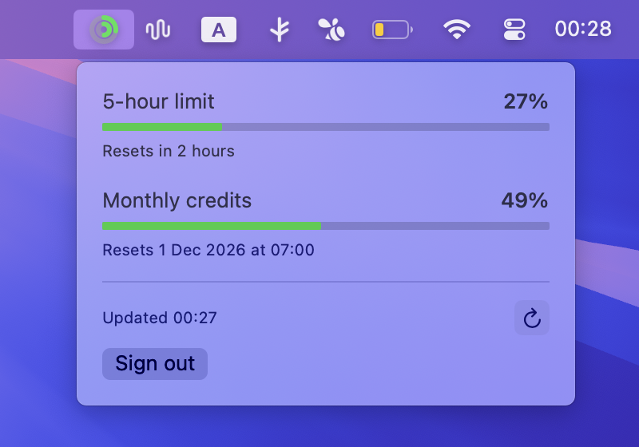

# Kimi Bar

An unofficial macOS menu bar app for monitoring **Kimi.ai** usage limits.

Compact rings show five-hour and monthly usage. The popover provides detailed usage, reset times, refresh status, and sign-in controls.



## Features

- Automatic refresh, including after sleep and network recovery
- Browser sign-in via OAuth device authorization
- Credentials stored in macOS Keychain

## Requirements

- macOS 14 or later
- A [Kimi.ai](https://kimi.ai) account; Kimi.com accounts are not supported

## Installation

1. Download the latest `KimiBar-v*.zip` from GitHub Releases.
2. Unzip it and move `KimiBar.app` to `/Applications`.

## Build from source

Open `KimiBar.xcodeproj` in Xcode and run the `KimiBar` scheme, or run:

```sh
make build
```

Run tests with:

```sh
make test
```

## Create a release archive

```sh
make release
```

This creates `.build/release/KimiBar-v<version>.zip` using the local Xcode signing settings. The app is not notarized; public distribution requires Developer ID signing and Apple notarization.

## Privacy

OAuth credentials are stored in macOS Keychain. A credential-free usage snapshot is cached in `~/Library/Application Support/KimiBar/usage-snapshot.json`. The app communicates with Kimi's authentication and usage APIs and contains no analytics.

## Disclaimer

Kimi Bar is independent and unofficial, with no affiliation or endorsement from Kimi or Moonshot AI.

## License

[MIT License](LICENSE)
